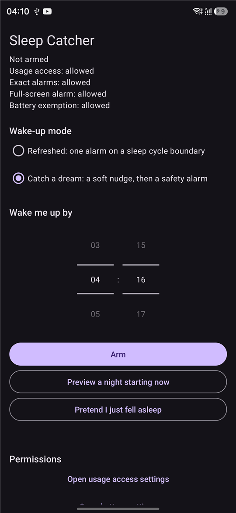
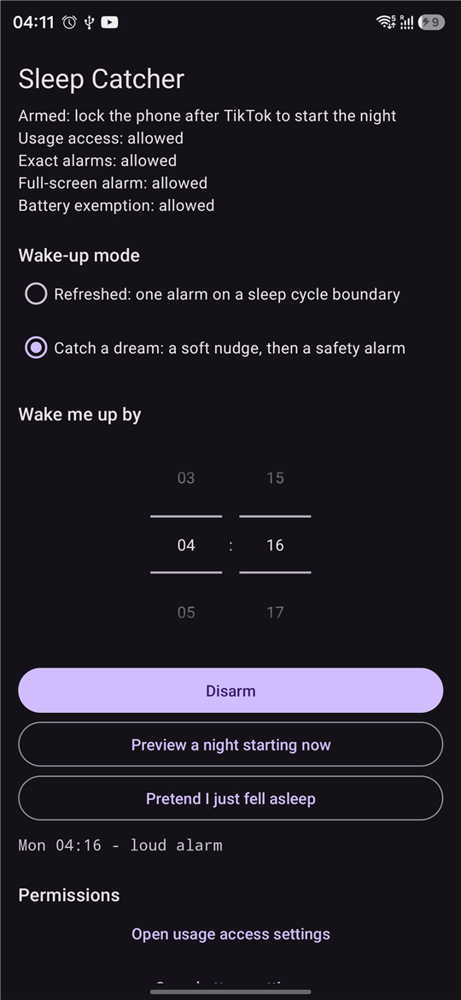
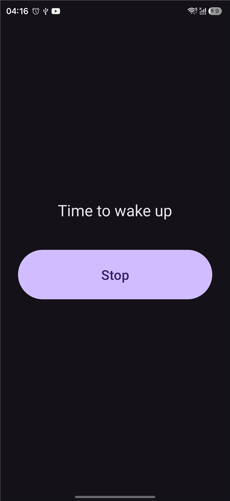
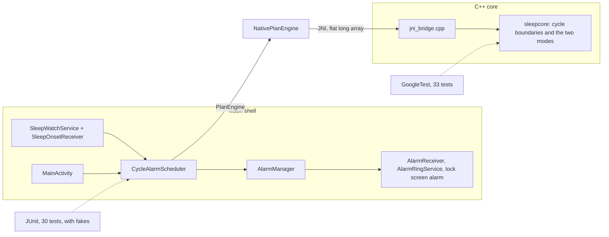

# Sleep Catcher

An Android alarm that counts sleep cycles from the moment you actually fall asleep, not from the moment you set the alarm.

[](https://github.com/STORM0090/sleep-catcher/actions/workflows/core-tests.yml)
[](LICENSE)

<p>
  
  
  
</p>

Early version. The core works and is tested, the screen is a plain settings page.

## What it does

The app watches for one habit: I scroll TikTok, then lock the phone. Screen off right after TikTok counts as the start of the night. From there the app counts 90-minute sleep cycles (starting 15 minutes after the screen went off) and sets the alarm on a cycle boundary.

There are two modes:

- **Refreshed**: one loud alarm on the last cycle boundary that is not after the target time. If that leaves fewer than three cycles, it takes the third boundary, even if that is a bit later than the target.
- **Catch a dream**: a soft vibration on the last cycle boundary that is at least 20 minutes before the target, then a loud alarm exactly at the target as a safety net. The loud alarm never rings later than the time you asked for. On a short night the soft vibration is skipped.

If you lock the phone again later in the night, the plan moves to the new moment, unless less than one cycle is left before the target.

The two modes come from my own notes on twelve nights with a Galaxy Watch 4: the sleep score did not predict whether I remembered a dream, how the night ended did. Seven nights is a tiny sample, so treat it as a hypothesis. Details: [docs/sleep-observations.md](docs/sleep-observations.md).

## Highlights

- **The planner is plain C++ with no Android code.** It works on integer milliseconds only, so the whole rule set builds and runs on a laptop in about a second. One test file walks over about 12,000 combinations of bedtime, target, mode and gap and checks what must always hold: the plan is never empty, times strictly increase, the last signal is the loud one, nothing rings before sleep starts.
- **The alarm is never later than asked.** In "Catch a dream" the loud alarm sits exactly on the target, and only the soft pulse is moved to a cycle boundary. The loud alarm uses `setAlarmClock`, the one alarm type that keeps firing on time in deep sleep mode.
- **Falling asleep is detected with a foreground service.** Android delivers `SCREEN_OFF` only to receivers that running code registered, so a small service keeps one alive. The app then asks `UsageStatsManager` which app was in front, with a 12 hour lookback, because scrolling a single feed creates no new events.
- **Failures are handled, not hoped away.** If exact alarms get revoked halfway through scheduling, everything already set is cancelled. After a reboot the saved plan is rebuilt, and signals that are already in the past are skipped, because Android fires an alarm set in the past immediately.
- **Three small interfaces, not more.** The planner, the settings and `AlarmManager` sit behind interfaces, so the scheduling logic is tested with fakes and no phone. The current time is passed in as a parameter instead of a clock class.

## Quick start

You need an Android phone with Android 10 or newer (only tested on a Galaxy S24 Ultra with Android 16), Android Studio, and JDK 17 for Gradle. Gradle downloads NDK 27.0.12077973 and CMake 3.22.1 on the first build.

In Android Studio: open the folder, set Settings > Build, Execution, Deployment > Build Tools > Gradle > Gradle JDK to JDK 17, connect the phone with USB debugging on, press Run. Or from a terminal:

```
./gradlew installDebug
```

On Windows use `gradlew.bat`. On first start switch on what the status block at the top reports as missing:

1. **Usage access**: "Open usage access settings", find Sleep Catcher, turn it on. Without it the app cannot see that TikTok was open.
2. **Notifications**: asked when you press Arm.
3. **Exact alarms**: granted automatically on Android 13 and newer.
4. **Full-screen alarm**: on Android 14 and newer a button appears if the alarm may not cover the lock screen.
5. **Battery**: optional, but Samsung stops background apps. On One UI add the app under Settings > Battery > Background usage limits > Never sleeping apps (the name differs a little between One UI versions).

Pick a mode and a time, press **Arm**, scroll TikTok, lock the phone. To try it without waiting for a night, set the time a few minutes ahead, choose "Catch a dream" and press "Pretend I just fell asleep". "Preview a night starting now" only shows the plan.

Decisions go to the log:

```
adb logcat -s SleepCatcher
```

## How it works



Why the core is C++: the rule is arithmetic on timestamps, and I know C++ better than Kotlin. Keeping it free of Android means it can be tested on a laptop instead of on a phone at 9 a.m., and the Android side has nothing left to get wrong except talking to the system. The bridge returns the plan as one array of numbers (`[warning, time, kind, time, kind, ...]`), which is much less JNI code than building Kotlin objects, and it checks the mode it receives and turns C++ exceptions into Java ones.

How it is checked: GoogleTest covers the core directly. JUnit covers the Kotlin logic (plan decoding, time zones and the daylight saving switch, the scheduler) with fake `PlanEngine`, `SettingsStore` and `AlarmGateway`. The real JNI path was also run on a PC through the actual Kotlin class. The story of how it came together is in [docs/how-it-was-built.md](docs/how-it-was-built.md).

## Tests

C++ core, no Android SDK needed:

```
cmake -S app/src/main/cpp -B build/sleepcore
cmake --build build/sleepcore
ctest --test-dir build/sleepcore --output-on-failure
```

On Windows with MinGW add `-G "MinGW Makefiles"` to the first command and put the MinGW `bin` folder on `PATH`. Kotlin logic, on the JVM, no phone or emulator:

```
./gradlew testDebugUnitTest
```

Current state: 33 GoogleTest tests and 30 JUnit tests pass. Both run on every push in the `tests` GitHub Actions workflow. The C++ job must pass, the Kotlin job is allowed to fail because the Android tooling on the runner changes without notice (it is green at the moment).

On the phone I checked by hand: TikTok then screen off schedules the plan, a screen off after another app does nothing, the alarm turns the screen on over the lock screen and Stop silences it, Disarm removes alarms and the watch, and a reboot in the middle of a test night restores the plan. In three alarms read from logcat the receiver fired 20 to 37 ms after the planned time.

## Limitations

- Tested on one phone. Not verified on a device: the Stop button in the notification, the two buttons that open the exact alarm and full-screen alarm settings (both permissions were already granted), a full real night, and Android 12 with exact alarms revoked.
- The trigger app is hard-coded: TikTok, both of its package names.
- The hour after which I wake up by myself anyway is fixed at 11:00. The warning about it only shows in the preview and when pretending to fall asleep, not at night.
- After a reboot the alarms come back only once the phone has been unlocked. On the S24 the system told the app about the boot about a minute and a half after the unlock (one measurement).
- If Samsung stops the background service and you do not open the app, a screen off can be missed. The loud alarm itself is not affected.
- Android logs which app is in front with a small delay, so locking the phone within a second of opening TikTok may not count.

## Roadmap

- A dream journal screen that opens right at the wake-up.
- Health Connect: read the night from the watch and store it next to the journal entry.
- A real UI and icons.

## License

MIT, Yehor Vorobiov. See [LICENSE](LICENSE).
